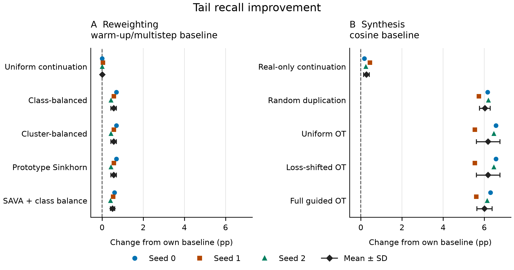

# Tables and figures

Descriptive summaries of the archived CIFAR-100-LT experiments. Each family
includes training seeds **0, 1, 2** on the fixed retained pool (data seed 42,
imbalance factor 0.01). The unit of replication is a training seed, not an image
or class. No hypothesis tests or significance claims are made.

## Tables

| Family | Read | Manuscript snippet | Numeric data |
|---|---|---|---|
| Reweighting | [Markdown](reweighting.md) | [LaTeX](reweighting.tex) | [CSV](reweighting.csv) |
| Synthesis | [Markdown](synthesis.md) | [LaTeX](synthesis.tex) | [CSV](synthesis.csv) |

The tables report **mean ± sample standard deviation** across the three seeds
(SD uses denominator n−1). Accuracy and macro Head/Medium/Tail recalls are
percentages. Accuracy changes are percentage points, calculated per seed against
the baseline in the same experiment family before their mean and SD are taken.
For example, the SD of changes is not the difference between two SDs.

Bold marks the highest unrounded mean within each table column, including ties.
It does not imply statistical significance. Balanced accuracy is omitted because
the balanced test set has 100 examples per class, making it equal to overall
accuracy. The baseline's change is shown as a dash; its numeric CSV value is zero.

LaTeX files are `table*` snippets requiring `\usepackage{booktabs,amsmath}`.
They are intended for adaptation to the manuscript template; a target journal
and article format have not been specified. LaTeX compilation was not available
in the generation environment.

## Figures

Overall accuracy: [PDF](accuracy_improvement.pdf), [SVG](accuracy_improvement.svg),
[PNG](accuracy_improvement.png).


**Figure 1. Overall accuracy change from each family's own baseline.** Panel A
contains reweighting continuations from the warm-up/multistep baseline. Panel B
contains synthesis and its controls from the cosine baseline. Circles, squares,
and triangles show seeds 0, 1, and 2. Black diamonds and horizontal error bars
show mean ± sample SD of the three paired changes. Vertical offsets separate
the seed markers from the summary; they encode no extra measurement. The dashed
line is zero change. Both panels use the same horizontal scale in percentage
points (pp). Baseline rows are omitted because all their changes are zero.

Tail recall: [PDF](tail_recall_improvement.pdf), [SVG](tail_recall_improvement.svg),
[PNG](tail_recall_improvement.png).



**Figure 2. Tail recall change from each family's own baseline.** Tail recall is
the macro average of class recalls for classes with fewer than 20 retained
training images. Layout, seed markers, units, reference line, and SD calculation
follow Figure 1. Both panels share the horizontal scale for this outcome.

Figures are 7.2 × 3.8 inches. PNG exports use 300 DPI (2160 × 1140 pixels).
PDFs embed TrueType fonts; SVG text remains editable and requires the displayed
font (DejaVu Sans) on the viewing system. The palette is supplemented by distinct
marker shapes. These are general manuscript figures, not verified compliance
with any journal's submission requirements.

## What is included

- Reweighting uses `../reweighting/runs/<method>_seed<N>/metrics.json`.
- Synthesis uses `../synthesis/comparison_5000_seed<N>/<method>_metrics.json`.
- The additional historical `../synthesis/comparison_seed0` experiment is outside
  the three-seed summaries; it remains preserved in the raw archive.
- All required results must be present and finite. Missing values are rejected,
  rather than replaced with zeros or silently dropped.
- [seed_metrics.csv](seed_metrics.csv) contains every plotted value, the absolute
  percentage scores, the family/method/seed identifiers, and the source file.
- [analysis.json](analysis.json) records the input hashes, calculation rules,
  full-precision summaries, figure dimensions, script hash, and software versions.

The two families used **different baseline and classifier recipes**. Within-family
changes describe each experiment; they do not isolate the effect of synthesis
versus reweighting under a common protocol. See the
[historical recipe details](../../docs/ot_methods.md#historical-recipes-and-comparisons).
All data and choices are descriptive of these existing experiments. The fixed
dataset and three training seeds do not quantify variation across new datasets.

## Reproduce

From the repository root, install the optional plotting dependency if needed:

```bash
python -m pip install -e '.[reporting]'
python scripts/report_results.py
```

An existing report directory is protected; regenerate the derived files with:

```bash
python scripts/report_results.py --overwrite
```

Use `--output-dir /path/to/new/report` to generate a separate copy. The script
refuses output paths inside the imported reweighting or synthesis directories.
It uses Matplotlib directly, with scoped styling and a temporary font cache;
no LaTeX executable, SciencePlots package, or network access is needed to render.

## Software and design references

Useful plotting references are
[SciencePlots](https://github.com/garrettj403/SciencePlots),
[Scientific Visualization: Python + Matplotlib](https://github.com/rougier/scientific-visualization-book),
and [Matplotlib's statistical examples](https://github.com/matplotlib/matplotlib/tree/main/galleries/examples/statistics).
The reporting script implements this project's figures without vendoring their code.

Analysis and figure review followed the statistical-analysis and
scientific-visualization procedures from Scientific Agent Skills:
Kassis, T., Agarwal, V., He, Y., Patel, D., & Brueckner, A. M. (2026).
*Scientific Agent Skills: A Library of Procedural Knowledge for Research Agents*.
[arXiv:2609.00065](https://doi.org/10.48550/arXiv.2609.00065).
