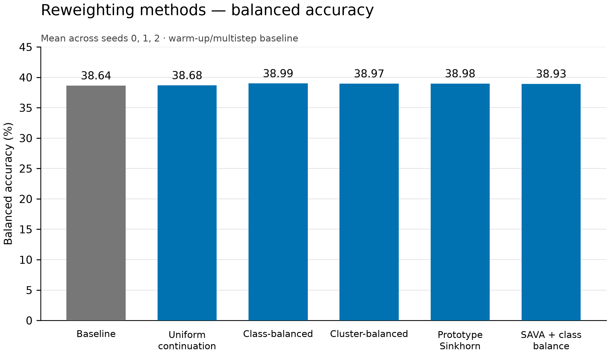
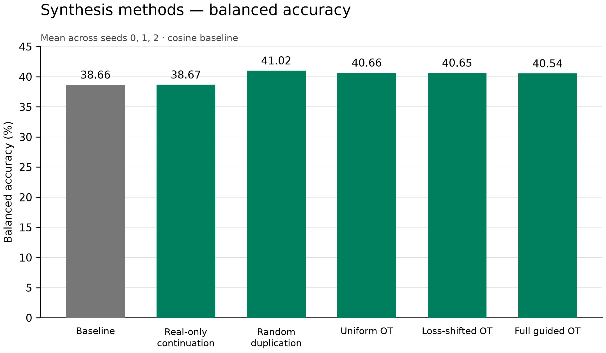
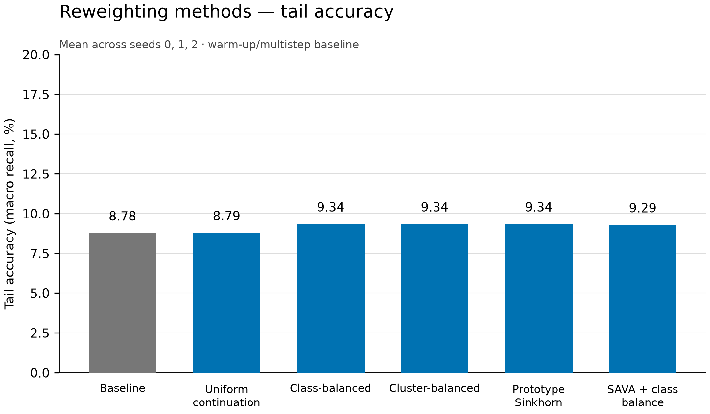
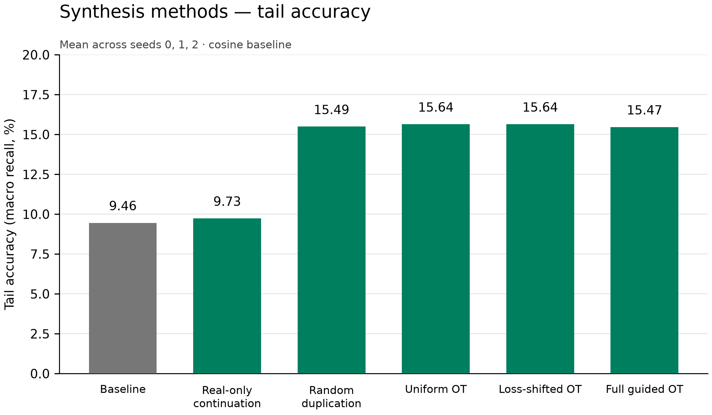

# Tables and figures

Descriptive summaries of the archived CIFAR-100-LT experiments. Each family
includes training seeds **0, 1, 2** on the fixed retained pool (data seed 42,
imbalance factor 0.01). The unit of replication is a training seed, not an image
or class. No hypothesis tests or significance claims are made.

## Tables

| Family | Read | Manuscript snippet | Numeric data |
|---|---|---|---|
| Reweighting | [Markdown](reweighting.md) | [LaTeX](reweighting.tex) | [CSV](reweighting.csv) |
| Synthesis | [Markdown](synthesis.md) | [LaTeX](synthesis.tex) | [CSV](synthesis.csv) |

The tables report **mean ± sample standard deviation** across the three seeds
(SD uses denominator n−1). Accuracy and macro Head/Medium/Tail recalls are
percentages. Accuracy changes are percentage points, calculated per seed against
the baseline in the same experiment family before their mean and SD are taken.
For example, the SD of changes is not the difference between two SDs.

Bold marks the highest unrounded mean within each table column, including ties.
It does not imply statistical significance. Balanced accuracy is omitted because
the balanced test set has 100 examples per class, making it equal to overall
accuracy. The baseline's change is shown as a dash; its numeric CSV value is zero.
The main charts read the saved `balanced_accuracy` metric directly; balanced
accuracy is the macro mean of all 100 class recalls.

LaTeX files are `table*` snippets requiring `\usepackage{booktabs,amsmath}`.
They are intended for adaptation to the manuscript template; a target journal
and article format have not been specified. LaTeX compilation was not available
in the generation environment.

## Figures



**Figure 1. Reweighting balanced accuracy.** Each bar shows mean balanced accuracy across
training seeds 0, 1, and 2. The baseline uses the
warm-up/multistep recipe. Numbers above the bars are mean balanced accuracy in
percent. Gray marks the baseline; blue marks the classifier continuations.



**Figure 2. Synthesis balanced accuracy.** Each bar shows mean balanced accuracy across
training seeds 0, 1, and 2. The baseline uses the
cosine recipe. Numbers above the bars are mean balanced accuracy in percent.
Gray marks the baseline; green marks the classifier continuations and controls.

These balanced-accuracy charts use the same zero-based axis, currently 0–45%.



**Figure 3. Reweighting tail accuracy.** Bars show mean macro Tail recall across
training seeds 0, 1, and 2. Tail classes have fewer than 20 retained training
images. Recall is averaged equally across these classes, then across seeds.
The baseline uses the warm-up/multistep recipe.



**Figure 4. Synthesis tail accuracy.** Bars show mean macro Tail recall across
training seeds 0, 1, and 2, using the same class definition and averaging as
Figure 3. The baseline uses the cosine recipe. Both tail-accuracy charts use
the same zero-based axis, currently 0–20%.

All four charts include all six methods in each family. There are no individual seed markers or legends;
method labels identify every bar. Small differences are easier to read precisely
in the accompanying tables. The charts show means only; variability across
training seeds remains available as sample SD in the tables.

Only PNG images are exported. Each figure is 7.2 × 4.2 inches at 300 DPI
(2160 × 1260 pixels), with a white background. These are general manuscript
figures, not verified compliance with a journal's submission requirements.

## What is included

- Reweighting uses `../reweighting/runs/<method>_seed<N>/metrics.json`.
- Synthesis uses `../synthesis/comparison_5000_seed<N>/<method>_metrics.json`.
- The additional historical `../synthesis/comparison_seed0` experiment is outside
  the three-seed summaries; it remains preserved in the raw archive.
- All required results must be present and finite. Missing values are rejected,
  rather than replaced with zeros or silently dropped.
- Summary CSV tables contain the full-precision means and SDs used by the charts.
- Original metrics, configurations, source commits, and file hashes remain in
  the [raw archive](../README.md) and [source manifest](../manifest.json).

The two families used **different baseline and classifier recipes**. Their results
describe each experiment; they do not isolate the effect of synthesis
versus reweighting under a common protocol. See the
[historical recipe details](../../docs/ot_methods.md#historical-recipes-and-comparisons).
All data and choices are descriptive of these existing experiments. The fixed
dataset and three training seeds do not quantify variation across new datasets.

## Reproduce

From the repository root, install the optional plotting dependency if needed:

```bash
python -m pip install -e '.[reporting]'
python scripts/report_results.py
```

The script generates only the two tables (Markdown, LaTeX, CSV) and four PNG
bar charts. An existing report directory is protected; regenerate with:

```bash
python scripts/report_results.py --overwrite
```

Use `--output-dir /path/to/new/report` to generate a separate copy. The script
refuses output paths inside the imported reweighting or synthesis directories.
It uses Matplotlib directly, with scoped styling and a temporary font cache;
no LaTeX executable, SciencePlots package, or network access is needed to render.
With `--overwrite`, it also removes the previous point plots, PDF/SVG exports,
and auxiliary JSON/seed CSV exports created by this script. Unrelated files are
preserved. The charts were generated with Matplotlib 3.11.2.

## Software and design references

Useful plotting references are
[SciencePlots](https://github.com/garrettj403/SciencePlots),
[Scientific Visualization: Python + Matplotlib](https://github.com/rougier/scientific-visualization-book),
and [Matplotlib's statistical examples](https://github.com/matplotlib/matplotlib/tree/main/galleries/examples/statistics).
The reporting script implements this project's figures without vendoring their code.

Analysis and figure review followed the statistical-analysis and
scientific-visualization procedures from Scientific Agent Skills:
Kassis, T., Agarwal, V., He, Y., Patel, D., & Brueckner, A. M. (2026).
*Scientific Agent Skills: A Library of Procedural Knowledge for Research Agents*.
[arXiv:2609.00065](https://doi.org/10.48550/arXiv.2609.00065).
